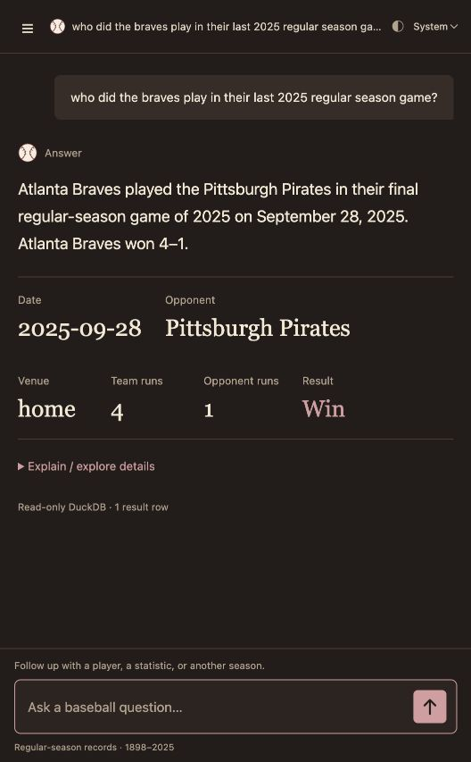

# Baseball notebook

A natural-language interface for historical MLB statistics, led by Riley Cook with substantial AI implementation and verification assistance. It turns a baseball question into a validated request for approved parameterized SQL. DuckDB calculates the answer from regular-season records covering 1898–2025.

This portfolio contains selected current implementation code, a demonstration screenshot and genuine verification records. The complete application and its data snapshot remain in a separate private repository. The invite-only friends/family pilot was deployed and verified on October 12, 2026; individual access links are controlled by the owner. There is no anonymous analytics demo.

## Implemented behavior

- A catalog of 51 approved analytical queries for player/team statistics, rankings, conditional game counts and first/final regular-season games.
- A constrained interpretation pipeline that checks identity, seasons, metrics, qualification, filters and completeness before executing fixed SQL.
- Targeted clarification and explicit unsupported responses instead of silently dropping conditions.
- Context-aware follow-ups that retain scope while validating edits, including a narrowly bounded season-command fix.
- A browser interface with temporary conversations, optional details and comparison charts.
- A separately hosted invite-only service with owner invitations, access revocation, durable outcome metadata and read-only analytical data. Private service/deployment components are excluded here.

## Current verification evidence

The frozen revised application genuinely passed **95/95 hosted-model cases** on October 12, 2026:75 baseline,16 held-out andfour game lookups, using Groq `qwen/qwen3.8-27b`. Exact IDs, source/model fingerprint and actual read-only database SHA were finalized. Historical October 7 public proof is preserved separately under `verification/releases/2026-10-07/` and is not reused to approve the current source.

Current real follow-ups preserve Aaron Judge while changing2024's 58 HR to2023's 37, and Atlanta/inclusive `home_runs >= 3` while changing 2023's 44/162 games to 2024's 30/162. The exact initial Braves wording uses zero model calls; the season edit used one real bounded Groq call. Component coverage of 100% describes recorded data for these results, not universal model accuracy.

The actual Free cloud service passed eight initial HTTP checks and 13 authenticated checks, including separate-account privacy, roles, quotas, restart-persistent activity, revocation and private-file protection. Sign-in/results/owner views were inspected at 390 × 844 without page overflow. The actual owner set their password directly and owner access was verified. Synthetic accounts were disabled; their traffic is not adoption. One observed idle wake took 22.256 seconds; no uptime or latency benchmark is claimed. CPU/RAM peak usage was unavailable on the Free metrics UI.

The revised preview passed 78 local checks, including 11 focused follow-up checks. Earlier regression totals belong to historical validations and are not recounted as current-source tests. The included database-free browser-helper file can be run with `node --test tests/test_ui_view_model.cjs`.

See [current proof](verification/), [pilot summary](verification/pilot-summary.json) and [provenance](PORTFOLIO_SCOPE.md). These records bind the complete private application's source/model/database, not a standalone build of this selected subset.

## Read the implementation

| Area | Selected code |
| --- | --- |
| Approved execution | [query_registry.py](src/analytics/query_registry.py) |
| Follow-up scope and season guard | [conversation.py](src/analytics/conversation.py) |
| Explicit metric conditions | [conditions.py](src/analytics/conditions.py) |
| Read-only DuckDB | [database.py](src/analytics/database.py) |
| Clarification | [clarification_guidance.py](src/analytics/clarification_guidance.py) |
| Result contract | [result_contract.py](src/analytics/result_contract.py) |
| Model transport | [model_gateway.py](src/analytics/model_gateway.py) |
| Fixed game selection | [Final-game SQL](sql/queries/team_season_final_game.sql) |
| Approved catalog | [analytics_catalog.json](config/analytics_catalog.json) |
| Browser | [web/](web/) |

See [architecture and tradeoffs](docs/architecture.md).

## Scope, contribution and limitations

This is a selected-code showcase. Python files depend on omitted application modules and the private data pipeline; the browser needs the private API. The model interprets requests rather than generating arbitrary SQL, calculating reported statistics or training new weights. Original local Ollama and hosted Groq are different model configurations with separate proof.

Riley defined product/testing goals, reviewed baseball use cases, approved narrow changes, completed guided service-account setup and controls pilot sharing. Implementation and verification used substantial AI assistance. The project does not claim every module was manually authored by Riley, professional deployment experience, real-user adoption, measured uptime or production scale.

Free capacity is shared; requests may pause or report busy/unavailable. Temporary conversations may reset when the service restarts or sleeps, while managed access and activity metadata persist. The dataset is historical, not live 2026 statistics. The finite approved-query catalog and recorded-data coverage limit analytical scope.

## Data attribution

The information used by the application was obtained free of charge from and is copyrighted by Retrosheet. See [Retrosheet](https://www.retrosheet.org/). This portfolio excludes the database/image, keys, private chats/account details and private deployment configuration.
