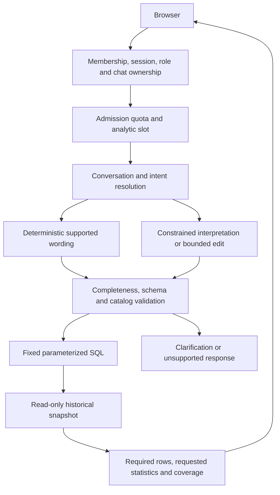

# Architecture and engineering tradeoffs

The application authenticates an invited person before interpreting a historical baseball question. It resolves complete supported wording directly when possible; otherwise the fixed hosted model proposes a structured request or bounded edit. Shared intent/completeness contracts require the supported metric, conditions, population, dates and relationships to survive that interpretation. The query registry validates a cataloged query and parameters, then fixed SQL computes results from an independent read-only DuckDB snapshot.

The model interprets language; it does not calculate the baseball totals or execute free-form SQL. This finite catalog improves auditability and scope checks at the cost of open-ended analytical flexibility. Recorded-data coverage is kept distinct from zero, a subtotal and a complete historical total.

Conversation edits preserve prior scope unless explicitly changed. Fresh Judge and Braves year edits demonstrate this boundary. The failed grouped home/road comparison led to a general required-row repair rather than hardcoded answers. Requested-stat projection retains identity and completeness fields needed to interpret the result.

Supabase supplies mutable identity/session/usage metadata; DuckDB supplies a reproducible analytical snapshot. Temporary SQLite chats have separate ownership and expiry. The owner activity view provides counts/outcomes, not transcripts. Server-only privileged credentials require backend role/ownership enforcement; browser keys and RLS alone do not replace those checks. Operational support references correlate allowlisted status/error/timing events without logging private questions, answers or provider bodies.

The hosted gateway uses fixed free `qwen/qwen3.8-27b`; the original local Ollama setup is separate. Typed errors distinguish request/user/model budgets, provider quota, busy capacity, timeouts and configuration faults. Actual retry headers govern provider deadlines. There is no automatic paid fallback or model switch.

Verification binds the complete private application to its exact case profile, model and database manifest. Current evidence has124 matching IDs with explicit70-retained/54-new provenance and both fresh real follow-ups. Failed runs are preserved. Cloud access, model, quota, responsive-browser, idle-recovery and durable metadata checks extend that evidence without establishing universal accuracy, always-on availability or production scale.

Packaging still needs separate checks. The first new image built but failed the normal startup import path. A container-path correction preserved the approved application fingerprint and strict gate, then actual deployment/startup were confirmed. A source hash is not a hash of every container binary or mutable base-image tag.

Current operation is an invite-only Free pilot. Chats can disappear on sleep/restart; managed identity/outcome metadata persists. Provider limits are shared. Owner acceptance and an actual31-table auth/public local logical restore passed October29, preserving exact comparisons and appRLS/anonymous denial. The encrypted copy checksum was verified and nativeOS reports cloud data present. No independent remote download/hash test or complete managedSupabase/GoTrue platform restore was performed. The stale-chat Retry recovery limitation remains documented. The public subset deliberately omits the complete server, data and private deployment configuration.
