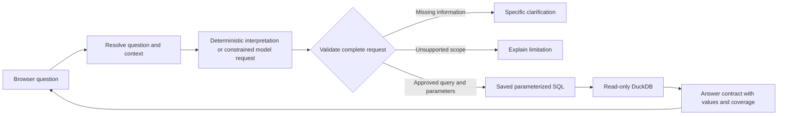

# Architecture and engineering decisions

The catalog is an allowlist of analytical capabilities. Model output identifies a saved query and supplies bounded fields; validation remains responsible for query compatibility, entity/time constraints and accepted conditions. It does not execute model-generated SQL. A concrete query must answer the complete question, including its filters.

Follow-ups resolve against the prior validated request. Model-assisted edits are constrained and revalidated. A fresh complete named-team question can start independently; ambiguous pronouns keep context. Missing information prompts a targeted clarification rather than an assumed default.

First/final regular-season games use date, game number and game ID to select one actual record. This matters for doubleheaders: the final Braves game in 2024 is game two of the September 30 doubleheader. Missing scores stay missing. Extra venue/opponent/stat filters are rejected if the saved query cannot honor them.

The model gateway keeps provider credentials server-side and returns schema-constrained output. It has no database/file tools. The database connection is read-only with external access disabled. The application calculates values from the database and exposes coverage rather than treating absent records as zero.

Verification combines local regression/boundary tests with actual hosted model calls. Approval is tied to source, model and database fingerprints. Progress is saved after each genuine pass; provider quota stops further requests until the requested retry time. Historical passes for a different fingerprint remain separate.

The project uses Python, DuckDB, pandas, parameterized SQL, vanilla JavaScript/CSS and schema-constrained model APIs. The original local configuration uses Ollama; the separately verified hosted candidate uses Groq. They are different models, with separate validation evidence.

## Tradeoffs

- An approved catalog limits breadth but makes interpretation and execution reviewable. Unsupported questions are explicit.
- A copied database snapshot keeps the owner's workspace independent, but data updates require a new release and fingerprint checks.
- Temporary conversations make a free pilot simpler. The full private app now uses durable invited accounts/session and outcome metadata, while transcripts remain temporary; durable transcripts would require a separate decision.
- Free provider capacity keeps operating cost bounded, but requests can pause at quota limits. No paid fallback is enabled.

## Current season-follow-up fix and hosted pilot

+An exact season-only command could leave redundant unconsumed command text after applying the year edit. Completeness validation then rejected the follow-up. The ten-line guard in `conversation.py` omits that fragment only when the whole exact command is fully represented. Other filters and fragments retain completeness validation. Eleven focused checks, 78 preview checks and a fresh 95-case hosted run passed; real post-finalization and deployed Braves edits preserved Atlanta and inclusive >=3home_runs.

+The private hosted app authenticates invited members, checks active roles and chat ownership, admits bounded question usage, then invokes this interpretation/validation/SQL path. Supabase holds mutable identity/session/usage and outcome metadata; DuckDB holds the separate read-only analytical snapshot. Full question text is not stored in owner activity. The current public summary contains verification outcomes, not private authentication or deployment configuration.
